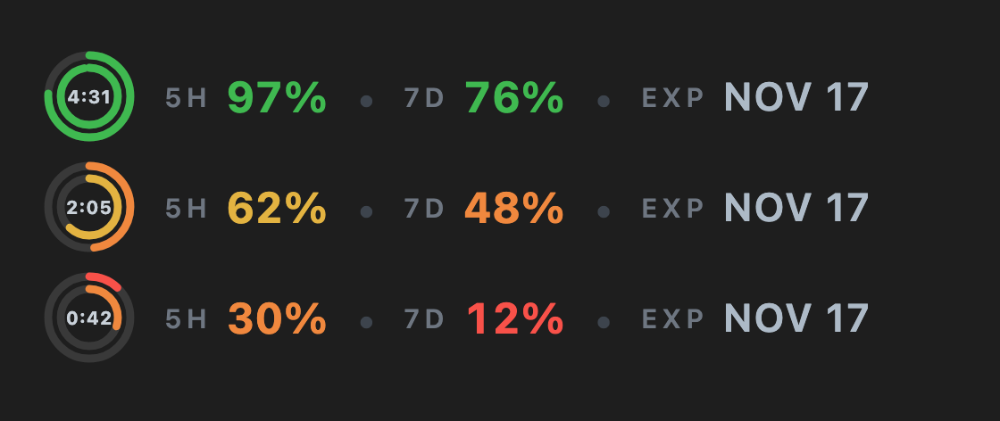

# Claude Usage Ring — See Your Claude Code 5-Hour and Weekly Limits at a Glance

**Claude Usage Ring (`quota-ring`) is a free, open-source Claude Code mod that shows how much of your Claude 5-hour and 7-day (weekly) usage limit is left, as a small color-coded double ring right above the prompt.** It also shows a countdown to the next 5-hour reset and your subscription renewal date, so you never get surprised by a rate limit in the middle of a task.

[English](#what-it-shows) · [中文说明](#中文说明)



## What it shows

```
◎  5H 97%  •  7D 76%  •  EXP NOV 17
```

| Part | Meaning |
| --- | --- |
| Inner ring | 5-hour usage window: how much is **left** (a full ring means fresh) |
| Number in the ring | Time until the 5-hour window resets, `H:MM` (e.g. `4:31`) |
| Outer ring | 7-day (weekly) usage window: how much is **left** |
| `5H` / `7D` | The same two windows as percentages left |
| `EXP` | Next subscription renewal date |

Rings and numbers change color by what is left:

| Left | Color |
| --- | --- |
| 75% or more | 🟢 green |
| 50% – 75% | 🟡 yellow |
| 25% – 50% | 🟠 orange |
| below 25% | 🔴 red |

It follows your light or dark theme. In a terminal session, where images can't be drawn, it falls back to one line of text.

## Install

At the prompt of a Claude Code terminal session:

```
/plugin install quota-ring --marketplace zoyluoblue/claude-usage
```

Answer `y` to add the marketplace, then pick the **user** scope so it loads in every session.

From a shell:

```bash
claude plugin install quota-ring --marketplace zoyluoblue/claude-usage
```

In the Claude desktop app (Code tab): click **+** next to the prompt box → **Plugins** → **Add marketplace** → enter `zoyluoblue/claude-usage` → **Add plugin**.

Installed at the user scope, the mod loads in every new Claude Code session on that computer, terminal and desktop app alike. Repeat the install on each computer you use.

## Requirements

- Claude Code with mod (function hook) support, signed in with a **Claude Pro or Max subscription**. API-key and third-party-provider sessions have no 5-hour or weekly window, so the ring stays grey.
- The figures arrive with Claude's replies: a brand-new session shows `--` until the first reply.

## How it works

- **Usage** comes from Claude Code's own rate-limit readings (`five_hour` and `seven_day`), the same numbers the status line uses. They are pushed to the mod after every turn; nothing is polled.
- **Countdown** is computed from the window's reset time and refreshes every 30 seconds.
- **Renewal date** is read once per session from your Anthropic account profile, through Claude Code's own signed-in connection. The profile carries the subscription start date but no end date, so the mod assumes **monthly billing** and shows the next monthly anniversary. If you pay yearly, that date is not your renewal.
- No data leaves your machine other than that one profile request to `api.anthropic.com`. No telemetry, no third-party servers.

## FAQ

**How do I check my Claude Code usage limit?**
Install this mod: the ring above the prompt shows the percentage left in your 5-hour and weekly windows at all times, with no command to run.

**When does my Claude 5-hour limit reset?**
The number inside the ring is the time left until the 5-hour window resets, e.g. `4:31` means 4 hours 31 minutes.

**Does it show used or remaining usage?**
Remaining. A full green ring means the window is fresh; it shrinks and turns yellow, orange, then red as you use it.

**Does it work in the terminal?**
Yes, as a single line of text (`5H 97% left, 7D 76% left, renews 2026-11-17`). The ring is drawn in the Claude desktop app.

**Is the renewal date exact?**
It is an estimate assuming monthly billing, based on when your subscription started.

## 中文说明

**Claude Usage Ring（`quota-ring`）是一个免费开源的 Claude Code mod，用一个小小的双色圆环，在输入框上方实时显示 Claude 5 小时额度和 7 天（每周）额度的剩余量。** 圆心显示 5 小时额度的重置倒计时，旁边显示订阅续费日期，写代码时不会再被额度用完打断。

- **内圈**：5 小时额度的剩余量，圆心是重置倒计时（如 `4:31`）
- **外圈**：7 天额度的剩余量
- **颜色**：剩余 75% 以上绿色，50% 以上黄色，25% 以上橙色，25% 以下红色
- **EXP**：下次订阅续费日期（按月付推算）

**安装**：在 Claude Code 终端会话的输入框里输入

```
/plugin install quota-ring --marketplace zoyluoblue/claude-usage
```

按 `y` 添加 marketplace，范围选 **user**，之后这台电脑上的所有会话都会加载。也可以在 Claude 桌面 App 的 Code 页面点输入框旁的 **+** → **Plugins** → **Add marketplace**，填 `zoyluoblue/claude-usage`，再点 **Add plugin**。每台电脑安装一次即可。

**要求**：登录 Claude Pro 或 Max 订阅；新会话在 Claude 第一次回复后才有数据。

## Keywords

Claude Code usage, Claude Code rate limit, Claude 5-hour limit, Claude weekly limit, Claude Max usage tracker, Claude Pro usage, Claude Code plugin, Claude Code mod, usage meter, quota monitor, reset countdown, Claude 额度, Claude 用量, 5 小时限额, 每周限额, Claude Code 插件.

## License

[MIT](LICENSE) © zoyluoblue
